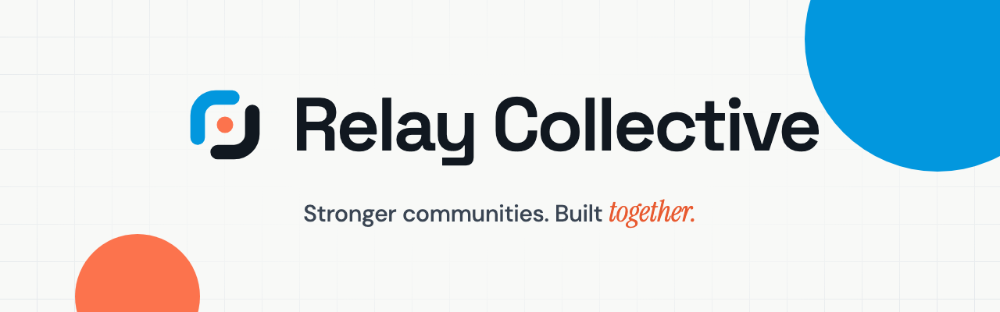
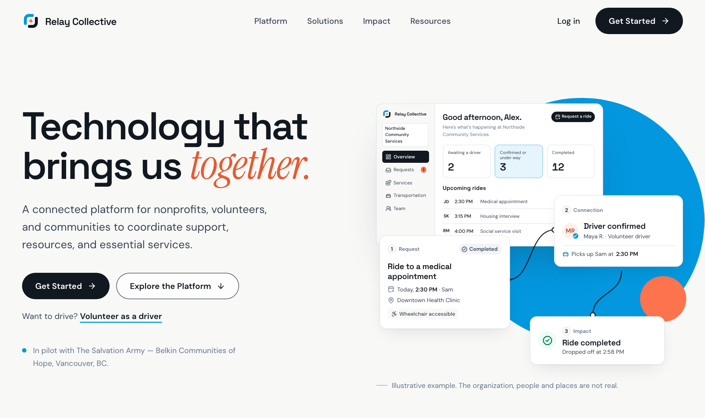
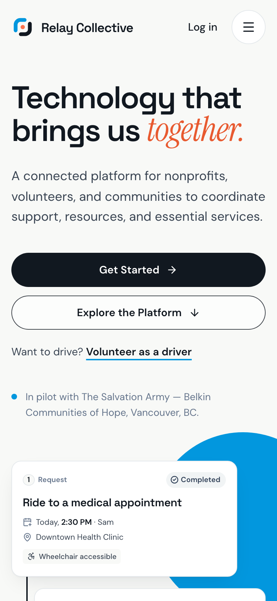
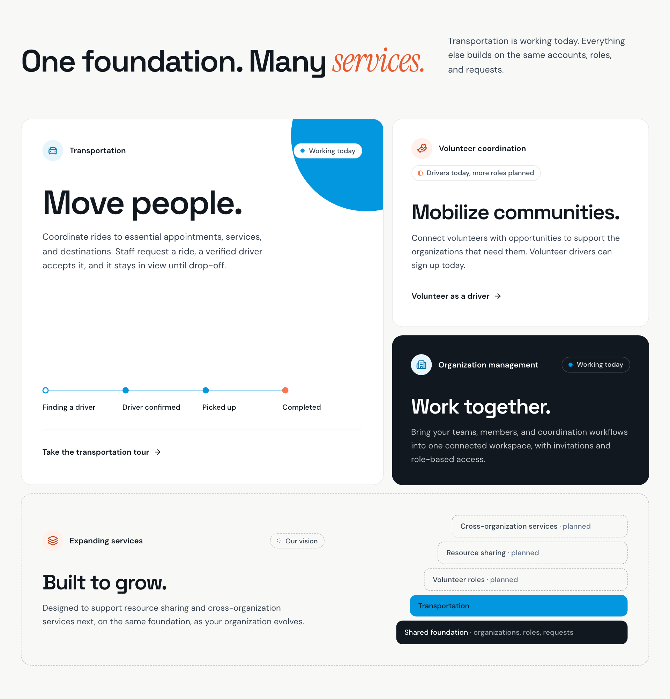
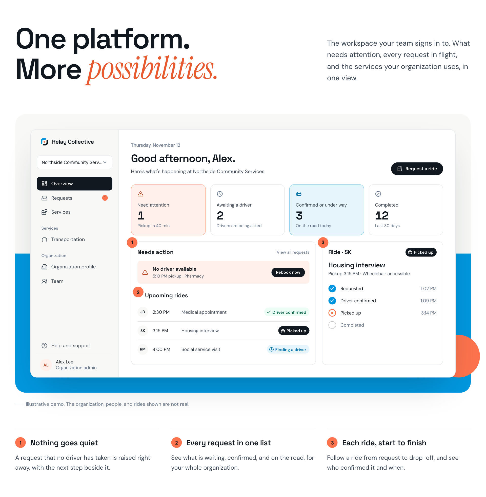

  

<h3 align="center">Shared digital infrastructure for nonprofits.</h3>

  Relay Collective connects nonprofit organizations, volunteers, and community resources, making it easier to coordinate services, collaborate across organizations, and reach the people who need support.

  
  
  

  
  
  
  
  
  

 

  
  &nbsp;
  

## 🧩 What we're building

One shared foundation, with services on top. Transportation is working today. Everything else builds on the same accounts, roles, and requests.

| Service | What it does | Status |
| --- | --- | --- |
| **Transportation** | Staff request a ride for someone they support, a verified driver accepts it, and it stays in view until drop-off. | Working today |
| **Volunteer coordination** | Connects volunteers with the organizations that need them. | Drivers today, more roles planned |
| **Organization management** | Teams, members, invitations, join requests, and role-based access in one workspace. | Working today |
| **Expanding services** | Resource sharing and cross-organization services, on the same foundation. | Planned |

  

### One workspace for the whole team

Organizations sign in to one workspace: what needs attention, every request in flight, and the services they use, in one view.

  

## Our story

Relay Collective started as a hackathon project at **FaithTech HACKVAN 2026**, developed in partnership with **The Salvation Army – Belkin Communities of Hope**, our pilot partner in Vancouver, BC.

Working alongside people on the front lines showed us where the barriers really are. Our first focus became clear: making **transportation** more accessible, reliable, and inclusive, because getting there is so often the first barrier between a person and the help that already exists.

That project has since grown into a long-term initiative. Transportation is where we started, but it isn't where we stop: we're building toward a broader collaboration platform where nonprofits can share resources, coordinate volunteers, and work together to serve their communities.

Relay Collective is an independent platform. The Salvation Army is our partner, not our owner.

---

   
  <b>Stronger communities. Built together.</b> 
  <a href="LICENSE">MIT License</a>

